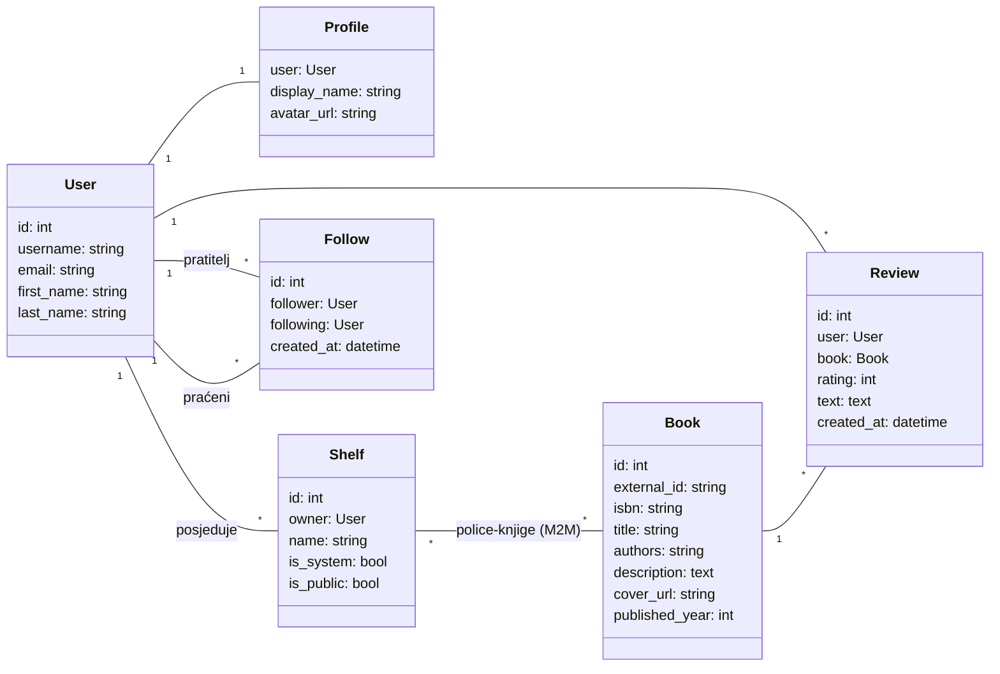
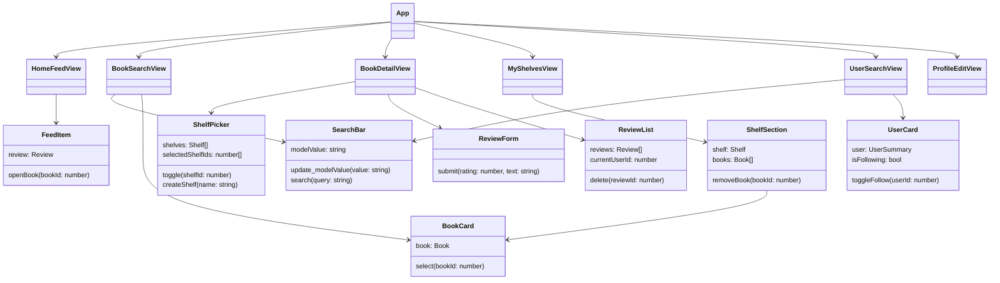

# RGKS Projekt

## Link
https://app-rgks-bgracin2.orangecoast-cae63067.polandcentral.azurecontainerapps.io/

## Upute

### Instalacija
- Backend
```bash
cd backend
python -m venv .venv
source .venv/bin/activate
pip install poetry
poetry install
```
- Frontend
```bash
cd frontend
npm install
```
### Napomene
- Napravi admin account da možeš vidjeti django admin stranicu:
```bash
cd backend
python manage.py createsuperuser
```
- Kad napravimo model moramo ga registrirati za admin stranicu u backend/api/admin.py, npr. ako smo napravili model Task moramo staviti:
```python
from .models import Task


admin.site.register(Task)
```
- Kad napravimo novu rutu moramo je staviti u backend/api/urls.py, npr. ovako:
```python
from django.urls import path

from . import views


urlpatterns = [
    path('tasks/', views.task_list, name='task-list'),
    path('tasks/<int:pk>/', views.task_detail, name='task-detail'),
]
```
- Stavio sam paginaciju u backend/config/settings.py i page size na 20 (kod "REST_FRAMEWORK = ...")

## Plan
### Baza

 
- `Review.rating` je 1–5, jedan po korisniku i knjizi (`unique_together(user, book)`). `Follow` također `unique_together` + zabrana praćenja sebe. 
- Many-to-many `Shelf`–`Book`, Django sam radi spojnu tablicu. Feed su recenzije praćenih korisnika, najnovije prvo.
- Ideja kod Shelf.is_system je da imamo već defaultne postavljene shelfove (npr. “Želim pročitati”, “Trenutno čitam”, “Pročitano”, “Favoriti”), a onda korisnik može dodavati svoje police ako želi. Police mogu biti javne ili privatne.

### Vue komponente

- `v-rating` — prikaz i unos ocjene (`readonly` za prikaz), u `ReviewForm`, `ReviewList` i `FeedItem`.
- `v-autocomplete` — pretraga s padajućim rezultatima, u `BookSearchView` i `UserSearchView`.
- `v-text-field` — obični unosi (npr. nadimak), u `SearchBar` i `ProfileEditView`.
- `v-card` i `v-avatar` — kartice i slike, u `BookCard`, `UserCard` i `FeedItem`.
- `v-list` — liste recenzija i knjiga, u `ReviewList` i `ShelfSection`.
- `v-textarea` i `v-btn` — tekst recenzije i slanje, u `ReviewForm`.
- `v-select` ili `v-chip-group` — odabir polica, u `ShelfPicker`.
- `v-tabs` — razdvajanje polica, u `MyShelvesView`.
- `v-file-input` (uz `v-avatar`) — upload profilne slike, u `ProfileEditView`.
- `v-pagination` ili `v-infinite-scroll` — paginacija feeda, u `HomeFeedView`.
- `v-skeleton-loader` ili `v-progress-circular` — loading stanja, na svim stranicama s dohvatom.
- `v-alert` — prazna stanja.
- `v-snackbar` — poruke o uspjehu i greškama, u `App`.
- `v-dialog` — potvrde brisanja.
- `v-app-bar` i `v-navigation-drawer` — navigacija te prijava i odjava, u `App`.

### types.ts
```ts
type UserSummary = {
  id: number;
  username: string;
  display_name: string;
  avatar_url: string | null;
  is_following?: boolean; // popunjeno kad gledamo drugog korisnika
};
```
```ts
type Profile = {
  display_name: string;
  avatar_url: string | null;
};
```
```ts
type ProfileInput = {
  display_name: string;
  avatar_url?: string | null;
};
```
```ts
type Book = {
  id: number;
  external_id: string;
  isbn: string;
  title: string;
  authors: string;
  description: string;
  cover_url: string | null;
  published_year: number | null;
};
```
```ts
type BookSummary = {
  id: number;
  title: string;
  authors: string;
  cover_url: string | null;
};
```
```ts
type Shelf = {
  id: number;
  name: string;
  is_system: boolean;
  is_public: boolean;
};
```
```ts
type Review = {
  id: number;
  user: UserSummary; // autor recenzije
  book: BookSummary; // za prikaz u feedu
  rating: number;    // 1..5
  text: string;
  created_at: string; // ISO datum
};
```

### Podjela poslova
- B: prijava i infrastruktura (CI/CD), profil (prikaz i uređivanje), pretraga korisnika, praćenje, feed praćenih.
- M: pretraga knjiga i dohvat s Open Libraryja, detalji knjige i keširanje, police (sistemske i vlastite), recenzije (ocjena i tekst).
